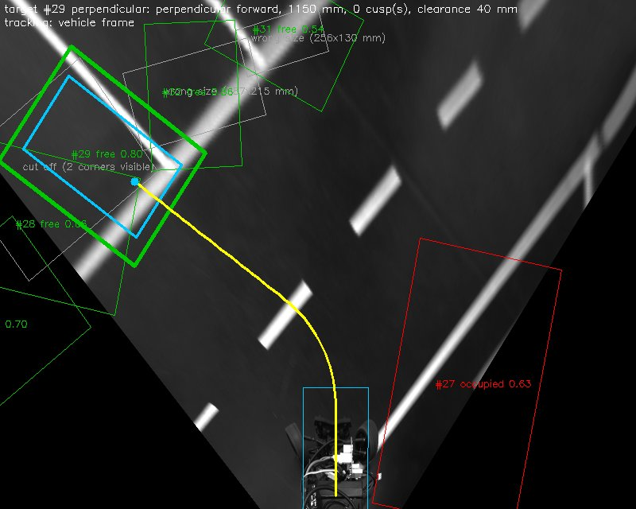
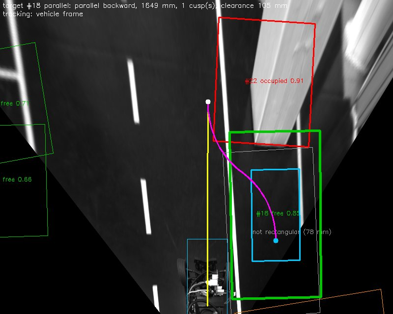

# Prototyp: von der Parkplatzerkennung zur Bahn ins Ziel

Dieses Dokument beschreibt den Prototyp, der an die vorhandene Detektion (YOLO-Pose bzw. ParkingNet) anschließt. Er bestimmt aus den erkannten Parkplätzen einen Zielplatz, prüft, ob das Fahrzeug hineinpasst, und plant eine fahrbare Bahn dorthin. Die Bahn wird ins Debug-Bild gezeichnet und zusätzlich als ROS-Topics für eine spätere Regelung veröffentlicht. Das eigentliche Einparken (Regelung, Ansteuerung) ist **nicht** Teil des Prototyps.

Stand: 04.11.2026 (Platzmaße nach CAuDri-Regelwerk 2026), Branch `YOLO/Pose` im Repo `parking` (noch nicht committet).

---

## 1. Kurzfassung

```text
BEV-Bild → YOLO-Pose (4 Ecken + Klasse)                         [vorhanden]
        → Sichtbarkeit der Ecken (schwarzer BEV-Bereich)        [neu]
        → Rechteck-Fit mit bekannter Geometrie (Kabsch)         [neu]
        → Tracking über Frames + Mehrheitsentscheid der Klasse  [neu]
        → Prüfung: frei? Footprint passt? Länge ≥ L_min?        [neu]
        → Zielpose der Hinterachse (x, y, ψ)                    [neu]
        → geometrischer Planer (Geraden + Kreisbögen)           [neu]
        → /parking/path, /parking/target_pose, /parking/path_segments, Debug-Bild
```

- Ein Durchlauf der neuen Pipeline dauert **3–5 ms pro Bild** (Laptop-CPU). Die Detektion dauert ~60 ms.
- Getestet auf den **drei Rosbags, die in keinem Datensatz stecken** (`13_35_42`, `13_37_32`, `13_38_33`). In 30–61 % der Frames wird ein Ziel mit Bahn gefunden, sowohl 90°- als auch Parallelplätze. Siehe Abschnitt 8.
- Die Platzmaße stammen aus dem **CAuDri-Challenge-Regelwerk 2026** (`CAuDri-Challenge_Regulations_2026.pdf`, Abschnitte 5.4 und A.5).
- 37 Unit-Tests, ruff (Workspace-Konfiguration) ohne Befund. Live mit ROS und Rosbag getestet.

---

## 2. Grundlagen aus der Literatur und daraus abgeleitete Entscheidungen

| Baustein | Ansatz | Quelle | Umsetzung |
|---|---|---|---|
| Erkennung | Parkplatz als Objekt mit Eckpunkten in der Vogelperspektive | DeepPS (Zhang et al., IEEE TIP 2018), DMPR-PS (Huang et al., ICME 2019), VPS-Net (Li et al., Sensors 2020), YOLO-Pose (Maji et al., CVPR-W 2022) | unverändert: `perception/yolo_model.py` |
| Rechteck-Fit | Starre Registrierung (Rotation + Translation) einer Schablone mit bekannten Maßen auf die erkannten Ecken, geschlossene Lösung nach kleinsten Quadraten | Kabsch (1976), Arun et al. (1987), Umeyama (IEEE TPAMI 1991) | `perception/geometry.py` |
| Tracking | Zuordnung nach nächstem Nachbarn, gleitender Mittelwert, Prädiktion mit konstanter Geschwindigkeit, Mehrheitsentscheid der Klasse | Standardverfahren der Multi-Target-Verfolgung (vgl. Bar-Shalom; Prädiktionsschritt wie im Kalman-Filter) | `perception/tracker.py` |
| Bezugspunkt | Mitte der Hinterachse, Einspurmodell | Rajamani, *Vehicle Dynamics and Control*; Pure Pursuit (Coulter 1992), Stanley (Thrun et al. 2006) | `planning/vehicle.py` |
| Mindestlänge parallel | L_min aus Wendekreis und Fahrzeuggeometrie | Paromtchik & Laugier (ICRA 1996), Vorobieva et al. (IEEE T-ITS 2015) | `VehicleGeometry.min_parallel_length` |
| 90°-Parken | Gerade – Kreisbogen (R ≥ R_min) – Gerade, Bogen tangential an beide Geraden | Dubins (1957); Reeds & Shepp (1990) für Rangierzüge | `planning/planner.py: plan_straight_arc_straight` |
| Parallelparken | Rückwärts-S-Kurve aus zwei Kreisbögen mit entgegengesetzter Krümmung | Paromtchik & Laugier (1996), „Kreis-Kreis“-Planer in Vorobieva et al. (2015) | `planning/planner.py: plan_parallel` |
| Schnittstelle | Bahn als stückweise konstante Krümmung κ(s) mit Richtungswechseln | Darstellung der Dubins-/Reeds-Shepp-Pfade | `planning/path.py` |

Bewusst **nicht** umgesetzt:
- **Reeds-Shepp vollständig / Hybrid A\*** (Dolgov et al. 2010): Auf der genormten Strecke ohne freie Hindernisse genügen die beiden klassischen Manöver. Sie sind nachvollziehbar und lassen sich direkt mit konstantem Lenkwinkel fahren.
- **Klothoiden** (stetige Krümmung): Die Bögen springen in der Krümmung, die Regelung muss das abfangen. Klothoiden wären der nächste Schritt (Abschnitt 9).
- **Flächenvergleich mit einer „reingelegten Box“:** Er ersetzt den Footprint-Test nicht. Ein langes, schmales Polygon kann genug Fläche haben, obwohl das Fahrzeug nicht hineinpasst. Deshalb wird das Fahrzeugrechteck in der Zielpose geometrisch auf Enthaltensein geprüft.

---

## 3. Neue und geänderte Dateien

Neu:

| Datei | Inhalt |
|---|---|
| `parking/perception/geometry.py` | `Pose2D` (2D-Pose mit Transformationen), `fit_rigid_transform` (Kabsch), `fit_rectangle` (Rechteck-Fit), Polygon-Abstände |
| `parking/perception/tracker.py` | `SpotTracker`, `Track`, `Measurement` |
| `parking/planning/vehicle.py` | `VehicleGeometry`: Footprint, R_min, L_min, Lenkwinkel aus Krümmung |
| `parking/planning/path.py` | `PathSegment` (Länge, Krümmung, Richtung), `Path` (Integration, Abtastung) |
| `parking/planning/planner.py` | die beiden geometrischen Planer |
| `parking/planning/target.py` | `ParkingPlanner`: Zielpose, Prüfungen, Auswahl mit Hysterese |
| `parking/pipeline.py` | `ParkingPipeline`: verbindet alles, unabhängig von ROS |
| `config/planning.yaml` | alle Parameter der neuen Pipeline |
| `tools/run_pipeline_on_bag.py` | Offline-Test auf einem Rosbag ohne laufendes ROS (Bilder, Video, Statistik) |
| `test/test_planning.py` | 37 Unit-Tests |

Geändert:

| Datei | Änderung |
|---|---|
| `parking/parking_perception_node.py` | ruft die Pipeline auf, veröffentlicht Bahn, Zielpose und κ(s), zeichnet das neue Debug-Bild |
| `parking/perception/model.py` | bestimmt pro Ecke, ob sie im gültigen Bildbereich liegt (`visible`) |
| `parking/perception/parking_spot.py` | neues Feld `visible` |
| `parking/perception/visualization.py` | neue Funktion `draw_parking` (alte `draw_spots` bleibt) |
| `config/model.yaml` | `visibility_border` |
| `config/ros_params.yaml` | neue Parameter und Topics |
| `package.xml` | Abhängigkeiten `nav_msgs`, `std_msgs` |
| `README.md` | neue Parameter, Topics, Verweis auf dieses Dokument |

Die Module unter `perception/geometry.py`, `perception/tracker.py`, `planning/` und `pipeline.py` brauchen nur numpy und yaml, kein ROS. Deshalb sind sie direkt mit pytest testbar und werden von Node und Offline-Tool gleichermaßen genutzt.

---

## 4. Koordinatensysteme und Konventionen

- **Fahrzeug-KS** (wie `camera_preprocessing`): x nach vorne, y nach links, in **mm**. In der BEV (800×640 px) entspricht Bild-oben +x und Bild-rechts −y, etwa 2,2 mm/px. Der untere Bildrand liegt bei x ≈ −120 mm.
- **Hinterachse:** Alle geplanten Posen beziehen sich auf die Mitte der Hinterachse, die bei `x = vehicle.rear_axle_x` liegt (Standard −85 mm, Annahme aus dem alten Paket `parking_spot`: Pose-Ursprung = Schwerpunkt, l_r = 85 mm). **Bitte am Fahrzeug nachmessen.**
- **Globales KS:** das der `pose_estimation` (`/pose_estimation/pose`, Position in mm, `orientation.z` = Gierwinkel in rad, *kein* Quaternion). Es wird angenommen, dass der Ursprung des Fahrzeug-KS der Kamera und der Pose übereinstimmen (wie im alten Paket).
- **Parkplatz-Pose:** Mittelpunkt und Richtung ψ der **langen Seite**. Diese Richtung ist um 180° mehrdeutig und wird erst bei der Zielpose festgelegt.
- **Ausgabe:** Die veröffentlichten Posen enthalten **echte Quaternionen** (`z = sin(ψ/2)`, `w = cos(ψ/2)`), damit RViz und Standard-Tools sie verstehen. Das weicht bewusst von der Konvention der `pose_estimation` ab.

---

## 5. Funktionsweise im Detail

### 5.1 Sichtbarkeit der Ecken (`model.py`)

In der Vogelperspektive sind die Bereiche außerhalb des Kamerasichtfelds schwarz (die Dreiecke links und rechts unten). Liegt ein Parkplatz teilweise dort, „rät“ das Netz die fehlenden Ecken. Die Auswertung der Annotationen hat gezeigt, dass solche Polygone deutlich verzerrt sind.

Deshalb wird die Maske der Pixel > 0 berechnet. Kleine dunkle Flecken werden per Closing geschlossen, und der Rand wird um `visibility_border` = 8 px erodiert. Eine Ecke gilt als sichtbar, wenn sie in dieser Maske liegt. Ergebnis: `ParkingSpot.visible` mit 4 Booleans.

### 5.2 Rechteck-Fit mit bekannter Geometrie (`geometry.py`)

Die Parkplätze haben bekannte Maße. Statt der 4 rohen Ecken wird ein Rechteck mit Nennmaß (Schablone) per kleinsten Quadraten auf die Ecken gelegt. Es bleiben 3 Freiheitsgrade: x, y, ψ.

1. **Zuordnung:** Das Netz sortiert die Ecken nach Bildkoordinaten (unten-links, unten-rechts, …), nicht nach der Geometrie des Platzes. Die Transformation Bild → Fahrzeug spiegelt außerdem die Umlaufrichtung. Deshalb werden alle **8 Zuordnungen** (4 Startecken × 2 Umlaufrichtungen) gerechnet, und die mit dem kleinsten Residuum gewinnt.
2. **Kabsch in 2D** (`fit_rigid_transform`): Für eine feste Zuordnung bildet die optimale Translation die gewichteten Schwerpunkte aufeinander ab. Der optimale Drehwinkel ist geschlossen lösbar:
   `ψ = atan2( Σ wᵢ (aᵢ × bᵢ), Σ wᵢ (aᵢ · bᵢ) )` mit den zentrierten Punkten aᵢ (Schablone) und bᵢ (Detektion).
3. **Gewichtung:** Nicht sichtbare Ecken bekommen das Gewicht 0,01. Schon **3 sichtbare Ecken** bestimmen ein Rechteck eindeutig. Abgeschnittene Plätze lassen sich so trotzdem verwenden. Das Residuum wird nur über die sichtbaren Ecken berechnet.
4. **Größenmessung:**
   - Alle 4 Ecken sichtbar: Nach dem ersten Fit wird mit der **gemessenen** Länge und Breite noch zweimal neu gefittet. Das Residuum misst dann nur noch, wie rechteckig die Ecken sind.
   - 3 Ecken sichtbar: Länge und Breite werden an den beiden sichtbaren Kanten gemessen (an der Ecke gegenüber der verdeckten), dann wird mit diesen Maßen gefittet. Das ist für Parallelplätze nötig, weil deren Länge nicht feststeht.

   Die Größe wird danach separat gegen das Regelwerk geprüft (5.2a).

Eine Detektion gilt als **geometrisch zuverlässig**, wenn:
- mindestens 3 Ecken sichtbar sind (`min_visible_corners`),
- das Residuum ≤ 50 mm ist (`max_residual`),
- die gemessene Größe zum Regelwerk passt (`size_tolerance` = 35 %, siehe 5.2a).

### 5.2a Platzmaße nach Regelwerk (CAuDri-Challenge 2026)

| Art | Regelwerk | Prüfung im Code |
|---|---|---|
| 90°, links (5.4.2, A.5.2) | alle Plätze gleich: **350 mm breit, 500 mm tief**, durch weiße Linien (18–20 mm) getrennt | Länge und Breite je ±35 % um 500 × 350 |
| Parallel, rechts (5.4.1, A.5.1) | **300 mm tief** (rechte Fahrbahnmarkierung bis zur äußeren Linie). **Länge variabel**: Die Plätze werden in Fahrtrichtung länger, der letzte ist ≥ 700 mm. Vorne und hinten begrenzen Hindernisse oder Sperrflächen. Lücken < 400 mm sind keine Plätze. | Breite ±35 % um 300, Länge nur ≥ 400 mm (`variable_length`, `min_length`); 700 mm dient nur als Startwert des Fits |

Weitere Punkte aus dem Regelwerk, die der Prototyp abbildet:
- „Ein Platz gilt als gesperrt, wenn das Fahrzeug nicht vollständig hineinpasst“ entspricht dem Footprint-Test (5.4).
- Gewertet wird, wenn alle Räder im Platz stehen. Der Footprint-Test prüft das ganze Fahrzeug plus Sicherheitsabstand, ist also strenger.
- Vorwärts und rückwärts Einparken sind erlaubt (7.4, „Vehicles may move forward or backward into the parking space“).
- Parallelplätze zwischen 400 und 558 mm (L_min) sind zwar gültige Plätze, aber für ein Einzug-Manöver zu kurz. Sie werden mit „too short for one maneuver“ abgelehnt. Da die Plätze in Fahrtrichtung länger werden, kommt danach ein passender.

Unzuverlässige Detektionen zählen trotzdem für die Klasse (Abschnitt 5.3), aber nicht für die Lage.

**Warum diese Schwellen:** Auf allen annotierten, vollständig sichtbaren 90°-Plätzen liegt das Residuum nach der Verfeinerung im Median bei 20 mm, 95 % liegen unter 39 mm. Abgeschnittene Plätze haben Residuen von 100–170 mm.

### 5.3 Tracking (`tracker.py`)

Ein einzelnes Bild ist verrauscht, und der Zielplatz verlässt während des Manövers das Bild. Deshalb wird jeder Parkplatz als **Track** geführt:

- **Bezugssystem:** Wenn `/pose_estimation/pose` empfangen wird (`use_pose: true`), wird im **globalen KS** verfolgt, und Plätze bleiben auch außerhalb des Bildes erhalten. Ohne Pose (so bei allen vorhandenen Rosbags) wird im **Fahrzeug-KS** verfolgt. Beim Wechsel zwischen beiden wird zurückgesetzt.
- **Prädiktion** (`predict_motion`): Alle Plätze sind statisch. Im Fahrzeug-KS bewegen sie sich deshalb gemeinsam mit der umgekehrten Eigenbewegung. Diese gemeinsame Verschiebung pro Frame wird als Median der Zuordnungs-Residuen geschätzt, geglättet und vor der Zuordnung auf alle Tracks angewendet. Das entspricht dem Prädiktionsschritt eines Kalman-Filters mit konstanter Geschwindigkeit. Ohne Zuordnung klingt sie ab. Eine Schätzung mit Rotation (Kabsch über die Platzmittelpunkte) war wegen des Rauschens deutlich schlechter (5× so viele Tracks) und wurde verworfen.
- **Zuordnung:** greedy nach dem kleinsten Abstand der Mittelpunkte, nur gleiche Art (90°/parallel), Gating 250 mm.
- **Glättung:** gleitender Mittelwert (`smoothing` = 0,4) für Mittelpunkt, Länge und Breite. Der Winkel wird als **doppelter Winkel** gemittelt (cos 2ψ, sin 2ψ), weil ein Rechteck um 180° symmetrisch ist.
- **Klasse:** Mehrheitsentscheid über die letzten 15 Detektionen (`vote_window`).
- **Bestätigung:** mindestens 3 Detektionen, davon 2 geometrisch zuverlässig. Gelöscht wird ein Track nach 10 Frames ohne Detektion.

### 5.4 Zielpose und Prüfungen (`target.py`, `vehicle.py`)

Für jeden bestätigten, **freien** Track (Mehrheitsentscheid):

1. **Fahrtrichtung im Platz:**
   - 90°: Die Fahrzeugachse liegt auf der langen Achse. Beim Vorwärtseinparken zeigt sie vom Fahrzeug weg in den Platz, beim Rückwärtseinparken zur Straße.
   - parallel: Die lange Achse liegt in der aktuellen Fahrtrichtung.
2. **Zielpose der Hinterachse:** Das Fahrzeug wird im Platz zentriert:
   `p_HA = c_Platz − d · (cos ψ, sin ψ)`, mit `d = L/2 − l_h` (Hinterachse → Fahrzeugmitte, hier 115 mm).
3. **Footprint-Test:** Das Fahrzeugrechteck plus `safety_margin` (20 mm) je Seite muss in der Zielpose **vollständig im gemessenen Platzrechteck** liegen. Geprüft wird der kleinste vorzeichenbehaftete Abstand der Fahrzeugecken zu den Kanten des konvexen Platzpolygons (`clearance`, muss ≥ 0 sein). Das ersetzt den reinen Flächenvergleich.
4. **Mindestlänge parallel** (Einzug-Manöver): In der letzten Kurve beschreibt die äußere Frontecke den größten Kreis um den Momentanpol. Sie muss an der Ecke des vorderen Hindernisses vorbeikommen. Daraus folgt (Paromtchik & Laugier 1996):

   `L_min = l_h + √( (R + b/2)² + l_v² − (R − b/2)² )`

   Mit den aktuellen Werten (R = 260 mm / tan 35° = **371 mm**, b = 200, l_v = 300, l_h = 70) ergibt sich **L_min = 558 mm**. Laut Regelwerk ist der letzte Parallelplatz ≥ 700 mm lang, ein Zug genügt dort also. Ist ein Platz kürzer, wird er mit „too short for one maneuver“ abgelehnt. Mehrzügige Manöver sind nicht umgesetzt.
5. **Bahnplanung** (5.5). Gibt es keine Bahn, wird der Grund gespeichert und im Debug-Bild angezeigt.

### 5.5 Bahnplanung (`planner.py`)

Beide Planer verwenden nur Geraden und Kreisbögen mit R = `radius_factor` · R_min. Jeder Abschnitt lässt sich also mit **konstantem Lenkwinkel** fahren: δ = atan(Radstand · κ), siehe `VehicleGeometry.steering_angle`.

**90°-Platz (links): Gerade – Bogen – Gerade**

Gesucht ist ein Kreisbogen mit Radius R, der tangential an die Gerade der aktuellen Fahrtrichtung und an die Mittellinie des Parkplatzes anschließt. Sein Mittelpunkt C hat zu beiden Geraden den Abstand R:

`P₀ + t·h₀ + s·R·n₀ = G − u·h_G + s·R·n_G`

Dabei ist h die Richtung, n die Linksnormale und s = ±1 die Drehrichtung. Das ist ein lineares 2×2-System für die Längen t (Anfahrt) und u (gerade Einfahrt).
- u < 0: Der Platz liegt seitlich zu nah, „too close to the spot“.
- t < 0: Der Wendepunkt ist schon überfahren. Das Fahrzeug setzt dann zuerst gerade zurück; die Bahn hat einen Umschaltpunkt (Cusp).
- Reihenfolge der Versuche: erst vorwärts, dann rückwärts einparken (`perpendicular_entry`). Rückwärts liegt die Hinterachse tiefer im Platz, das ist bei seitlich nahen Plätzen oft noch machbar.

**Parallelplatz (rechts): Rückwärts-S-Kurve**

Das Fahrzeug fährt geradeaus bis zum Startpunkt der S-Kurve und setzt dann zurück: erst nach rechts eingeschlagen, dann nach links. Konstruiert wird rückwärts vom Ziel aus:
- Der letzte Bogen liegt auf dem Kreis mit Mittelpunkt C₁ = (0, s·R) im Ziel-KS.
- Der erste Kreis berührt ihn: C₂ = C₁ + 2R·(sin α, −s·cos α).
- C₂ muss den Abstand R zur Anfahrtsgeraden haben. Daraus folgt α geschlossen: `α = s·φ + arccos(−s·k)`, mit dem Winkelfehler φ zwischen Fahrzeug und Platz. Die Winkel der beiden Bögen sind α und β = α − s·φ.

Ist das Fahrzeug parallel zum Platz (φ = 0), ergibt sich der Lehrbuchfall `α = β = arccos(1 − Δy / 2R)` und `Δx = 2R·sin α`. Kleine Winkelfehler (bis `max_heading_error` = 15°) werden also exakt ausgeglichen. Steht das Fahrzeug schon in Linie mit dem Platz (Querversatz < 30 mm), wird nur gerade gefahren.

Alle Planer sind in den Tests darauf geprüft, dass die **integrierte Bahn exakt in der Zielpose endet**.

### 5.6 Auswahl des Ziels

Unter allen machbaren Kandidaten wird der mit der **kürzesten Bahn** gewählt (optional nur eine Art, `preferred_kind`). Danach gilt **Hysterese**: Das Ziel bleibt, solange es machbar ist. Sonst würde die Regelung zwischen zwei fast gleich langen Plätzen hin- und herspringen. Auf den Test-Bags halbierte das die Zielwechsel.

Bahn und Ziel werden **in jedem Frame neu geplant** (im Fahrzeug-KS ab der aktuellen Hinterachsposition). Neue Detektionen korrigieren die Zielpose also laufend.

### 5.7 Schnittstelle zur Regelung (ROS-Topics)

| Topic | Typ | Inhalt |
|---|---|---|
| `/parking/path` | `nav_msgs/Path` | Posen der Hinterachse alle 20 mm (`sample_step`), Fahrzeug-KS zum Zeitpunkt des Bildes, mm, Quaternion. **Leer, wenn es kein Ziel gibt.** |
| `/parking/target_pose` | `geometry_msgs/PoseStamped` | Zielpose der Hinterachse, nur bei Ziel |
| `/parking/path_segments` | `std_msgs/Float32MultiArray` | κ(s): pro Segment `[Länge mm, Krümmung 1/mm, Richtung +1/−1]`, ab der aktuellen Hinterachse. Leer ohne Ziel. |
| `/parking/debug_image` | `sensor_msgs/Image` | nur mit `debug:=True` |

`/parking/path_segments` ist die eigentliche Übergabe an die Regelung: Krümmung und Fahrtrichtung pro Abschnitt, Richtungswechsel sind explizit. Eine Funktion y = f(x) wurde bewusst nicht verwendet, weil sie Rückwärtszüge und Umschaltpunkte nicht abbilden kann. Ein Pure-Pursuit- oder Stanley-Regler kann alternativ direkt `/parking/path` folgen. Für die Arbeit wäre ein eigenes Message-Paket (z. B. `parking_msgs/ParkingPath`) sauberer als `Float32MultiArray`.

### 5.8 Debug-Bild

| 90°-Platz: Gerade – Linksbogen – Gerade | Parallelplatz: vorbeifahren, Umschaltpunkt, Rückwärts-S-Kurve |
|---|---|
|  |  |

(Bag `13_37_32`, Frames 690 und 534, erzeugt mit dem Offline-Tool aus 7.2)

- **Grün / rot / orange Rahmen:** verfolgter Platz frei / besetzt / gesperrt, mit `#Track-ID Klasse Score`. Dünn = noch nicht bestätigt, dick = bestätigt.
- **Grau, dünn:** einzelne Detektion mit unzuverlässiger Geometrie, mit Grund („cut off (2 corners visible)“, „not rectangular“, „wrong size“)
- **Sehr dicker grüner Rahmen:** Zielplatz
- **Hellblau:** Fahrzeugumriss jetzt (unten) und in der Zielpose; Punkt = Hinterachse im Ziel
- **Gelb:** Bahn vorwärts, **Magenta:** Bahn rückwärts, **weißer Punkt:** Umschaltpunkt
- **Text oben:** Zielplatz, Manöver, Bahnlänge, Anzahl Umschaltpunkte, Abstand zum Platzrand; darunter das Bezugssystem des Trackings
- Text an freien, bestätigten Plätzen ohne Bahn: Grund (z. B. „fw: too close …; bw: …“)

---

## 6. Konfiguration (`config/planning.yaml`)

| Abschnitt | Parameter | Wert | Bedeutung |
|---|---|---|---|
| `classes` | Label → `kind`, `status` | | Bedeutung der 6 CVAT-Labels |
| `spot_geometry` | `perpendicular` | 500 × 350 | Regelwerk A.5.2 |
| | `parallel` | Breite 300, Länge variabel (≥ 400, Startwert 700) | Regelwerk 5.4.1 / A.5.1 |
| `rectangle_fit` | `min_visible_corners` | 3 | |
| | `refine_iterations` | 2 | Größenverfeinerung |
| | `max_residual` | 50 mm | |
| | `size_tolerance` | 0,35 | |
| `tracker` | `gate`, `smoothing`, `min_hits`, `min_valid_hits`, `max_misses`, `vote_window`, `predict_motion` | 250, 0,4, 3, 2, 10, 15, true | |
| `vehicle` | `wheelbase`, `max_steering_angle`, `length`, `width`, `rear_overhang`, `rear_axle_x` | 260, 35°, 370, 200, 70, −85 | **nachmessen** |
| `planner` | `safety_margin` | 20 mm | Abstand je Seite beim Footprint-Test |
| | `radius_factor` | 1,0 | R = Faktor · R_min (> 1 lässt der Regelung Reserve) |
| | `perpendicular_entry` | [forward, backward] | Reihenfolge der Versuche |
| | `max_heading_error` | 15° | parallel |
| | `preferred_kind` | any | |
| | `sample_step` | 20 mm | Abstand der Posen in `/parking/path` |

In `config/ros_params.yaml` sind neu: `planning_config_path`, `use_pose`, `frame_id` und die drei Topics. In `config/model.yaml` ist neu: `visibility_border`.

Mit `--symlink-install` gelten Änderungen an den YAML-Dateien nach einem Neustart der Node. Neu bauen muss man nur, wenn Dateien hinzukommen.

---

## 7. Testen

Alle Befehle aus `~/smarty_workspace`, vorher:

```bash
cd ~/smarty_workspace && source install/setup.zsh
colcon build --symlink-install --packages-select parking   # einmal, wegen der neuen Dateien
```

### 7.1 Unit-Tests (ohne ROS, ~1 s)

```bash
cd src/parking && python3 -m pytest test/test_planning.py -q
```

Geprüft wird unter anderem:
- Der Rechteck-Fit findet die Pose bei jeder Eckenreihenfolge und ignoriert verdeckte Ecken.
- Alle Planer enden exakt in der Zielpose (auch mit Winkelfehler und Rangierzug).
- L_min stimmt mit der Formel überein.
- Der Tracker stimmt korrekt ab, prädiziert und löscht Tracks.
- Die Pipeline wählt freie Plätze, ignoriert besetzte und funktioniert im globalen KS.
- Die Hysterese hält das Ziel.

### 7.2 Offline auf einem Rosbag (ohne laufendes ROS)

Am schnellsten iterieren lässt sich mit dem Offline-Tool. Es verarbeitet die Rohbilder wie `camera_preprocessing`, lässt Detektor und Pipeline laufen, schreibt Debug-Bilder (PNG und/oder Video) und gibt eine Statistik aus:

```bash
python3 src/parking/tools/run_pipeline_on_bag.py \
    /home/smartrollerz/rosbags/rosbag2_2026_10_28-13_37_32 /tmp/parking_debug --video
```

| Option | Bedeutung |
|---|---|
| `--every N` | jedes N-te Bild (Standard 3 ≈ 10 Hz, ähnlich der Node) |
| `--video` | schreibt `debug.mp4` |
| `--no-images` | keine PNGs, nur Statistik/Video |
| `--max-frames N` | nach N Bildern abbrechen |
| `--model-config`, `--planning-config` | andere Konfigurationen (relativ zu `src/parking`) |

Die Statistik am Ende enthält:
- Gründe, aus denen Detektionen verworfen wurden
- Zustand der freien Plätze (machbar oder warum nicht)
- Frames mit Ziel pro Art
- **gemessene Platzgrößen** (Median der vollständig sichtbaren, zuverlässigen Detektionen): Damit lassen sich die Nennmaße in `spot_geometry` prüfen.
- Laufzeiten

Tipp: Für Parameterstudien zuerst auf einem Bag laufen lassen, dann einzelne Werte in `planning.yaml` ändern und vergleichen.

### 7.3 Live mit ROS und Rosbag

Jeder Befehl in einem eigenen Terminal (jeweils nach `source install/setup.zsh`):

```bash
ros2 launch camera_preprocessing camera_preprocessing.launch.py
ros2 launch parking parking_perception.launch.py debug:=True
/usr/bin/python3 /opt/ros/jazzy/lib/rqt_image_view/rqt_image_view /parking/debug_image
ros2 bag play /home/smartrollerz/rosbags/rosbag2_2026_10_28-13_37_32
```

Ausgaben prüfen:

```bash
ros2 topic hz /parking/path                # ~8–9 Hz auf dem Laptop
ros2 topic echo /parking/path_segments     # z. B. [675, 0, 1, 580, 0.0027, 1, 148, 0, 1]
ros2 topic echo /parking/target_pose
```

Das Beispiel liest sich so: 675 mm geradeaus, 580 mm Linkskurve mit κ = 0,0027/mm (R = 371 mm), 148 mm geradeaus in einen 90°-Platz.

Im Log der Node steht pro Bild zusätzlich die Zeit `planning` (3–5 ms).

**Mit Pose:** Die vorhandenen Bags enthalten nur `/camera/image/raw`, das Tracking läuft dort im Fahrzeug-KS. Für Tests im globalen KS bitte künftig mit aufzeichnen:

```bash
ros2 bag record /camera/image/raw /pose_estimation/pose /sensor/imu /sensor/velocity /sensor/steering_angle
```

---

## 8. Ergebnisse und Erkenntnisse aus den Daten

### 8.1 Ungesehene Rosbags (jedes 3. Bild)

| Bag | Frames | Frames mit Ziel | davon 90° | davon parallel | Pipeline | Detektion |
|---|---|---|---|---|---|---|
| `13_37_32` | 319 | 159 (50 %) | 76 | 83 | 3,7 ms | 60 ms |
| `13_35_42` | 398 | 241 (61 %) | 178 | 63 | 4,8 ms | 62 ms |
| `13_38_33` | 299 | 91 (30 %) | 85 | 6 | 4,3 ms | 65 ms |

(Mit den Regelmaßen. Mit den vorläufigen Maßen vom 02.11. waren es 135 / 191 / 124 Frames.)

In den übrigen Frames ist kein freier Platz bestätigt oder das Manöver geometrisch nicht möglich, meistens „too close to the spot“: Der 90°-Platz liegt schon neben oder hinter dem Fahrzeug. Visuell geprüft:
- 90°-Plätze: typisches Gerade–Linksbogen–Gerade-Manöver.
- Parallelplätze: Vorbeifahren, Umschaltpunkt, Rückwärts-S-Kurve in den freien Platz hinter einem besetzten. Die Anfahrtsstrecke schrumpft beim Vorbeifahren gleichmäßig, die Planung ist über die Frames also stabil.

Achtung: „Frames mit Ziel“ ist kein Genauigkeitsmaß, denn für die Bags gibt es keine Ground Truth der Bahn. Für die Arbeit sollte die Genauigkeit in mm/Grad gemessen werden (Abschnitt 9).

### 8.2 Tracker-Varianten (Fahrzeug-KS, ohne Pose, mit Hysterese, vorläufige Maße vom 02.11.)

| Bag | Prädiktion | Tracks erzeugt | Doppel-Tracks* | Frames mit Ziel | Zielwechsel |
|---|---|---|---|---|---|
| `13_37_32` | an | 46 | 15 | 135 | 6 |
| | aus | 46 | 32 | 140 | 3 |
| `13_35_42` | an | 48 | 0 | 191 | 3 |
| | aus | 61 | 0 | 124 | 6 |
| `13_38_33` | an | 64 | 1 | 124 | 6 |
| | aus | 63 | 1 | 100 | 5 |

\* Paare bestätigter Tracks derselben Art mit weniger als 200 mm Abstand, aufsummiert über alle Frames.

Die Prädiktion halbiert die Doppel-Tracks und bringt auf zwei Bags deutlich mehr Frames mit Ziel. Ohne Hysterese lagen die Zielwechsel bei 12/7/10. Mit Pose im globalen KS sollten beide Effekte kleiner werden, das ist aber noch nicht getestet (keine Pose in den Bags).

### 8.3 Erkenntnisse zur Geometrie

- **Kalibrierung:** Im Nahbereich ist sie gut. Auf dem Kalibrierfoto `chessboard_2026-10-28.png` ergeben die 50-mm-Quadrate 51,5 bzw. 52,8 mm (3–5 % Fehler).
- **Gemessene Platzmaße vs. Regelwerk:** Alle Detektionen mit ≥ 3 sichtbaren Ecken und Residuum < 50 mm, Median pro Bag:

  | | Regelwerk | gemessen |
  |---|---|---|
  | 90° Tiefe × Breite | 500 × 350 | 497–574 × 326–378 |
  | Parallel Tiefe | 300 | **403–426** |
  | Parallel Länge | variabel, 400 bis ≥ 700 | 430–1010 (10.–90. Perzentil) |

  Die **90°-Plätze passen** zum Regelwerk. Die **Parallelplätze sind auf euren Bags ~40 % tiefer als 300 mm**, und zwar in allen drei Bags gleich. Die Linienbreite (18–20 mm) erklärt das nicht. Entweder ist die Teststrecke dort breiter als im Regelwerk, oder die Polygone wurden bis über die Linie hinaus annotiert. Viele Parallel-Detektionen werden deshalb mit „wrong size“ verworfen, auf `13_38_33` bleiben nur 6 Frames mit parallelem Ziel. **Bitte die Tiefe der Parallelplätze auf der Teststrecke nachmessen.** Ist die Strecke wirklich breiter, für Tests lokal `parallel.width` auf den gemessenen Wert setzen. Für den Wettbewerb gilt 300 mm.
- **Abgeschnittene Plätze:** In den Annotationen (v4–v6) berührt die Mehrheit der Plätze den schwarzen BEV-Rand. Ohne die Sichtbarkeitsprüfung wären diese verzerrten Polygone in die Lage eingeflossen. Mit dem gewichteten Fit sind Plätze mit 3 sichtbaren Ecken trotzdem nutzbar.

---

## 9. Grenzen und nächste Schritte

Wichtig für den Einsatz im Fahrzeug:
1. **Maße nachmessen:** Fahrzeug (Länge, Breite, Überhang, Lage der Hinterachse im Kamera-KS `rear_axle_x`, maximaler Lenkwinkel) und Parkplätze. L_min und alle Bahnen hängen direkt davon ab.
2. **Rosbags mit Pose aufnehmen** (7.3) und das Tracking im globalen KS testen. Erst dann bleibt der Zielplatz erhalten, wenn er im Manöver das Bild verlässt.
3. **Regelung anbinden:** Pure Pursuit oder Stanley auf `/parking/path` bzw. Lenkwinkel aus `/parking/path_segments`. Für die Ausführung muss die Bahn dann im globalen KS festgehalten werden (jetzt: in jedem Frame neu im Fahrzeug-KS).

Verbesserungen:
- **Eigenes Message-Paket** (`parking_msgs`) für Plätze, Ziel und Bahn statt `Float32MultiArray`.
- **Klothoiden-Übergänge** zwischen Gerade und Bogen (stetige Krümmung, Vorobieva et al. 2015) oder ein vollständiger **Reeds-Shepp**-Planer (z. B. aus AtsushiSakai/PythonRobotics) für mehrzügige Manöver in kurzen Lücken.
- **Benachbarte freie Parallelplätze zu einer Lücke zusammenfassen**, bevor L_min geprüft wird.
- **Klassenunabhängiges NMS** im YOLO-Aufruf (`agnostic_nms=True`): Derzeit kann derselbe Platz theoretisch gleichzeitig als „frei“ und „besetzt“ erkannt werden.
- **Kollisionsprüfung entlang der Bahn** gegen besetzte/gesperrte Plätze (jetzt nur der Footprint im Ziel).
- **Evaluation für die Arbeit:** Ecken-, Mittelpunkt- und Winkelfehler in mm/Grad auf einem zurückgehaltenen, annotierten Bag; F1 je Klasse; Latenz auf dem NUC. Der Rechteck-Fit lässt sich direkt mit den Annotationen vergleichen (Mittelpunkt/Winkel Netz+Fit vs. Annotation).
- **Aufräumen:** Der Abschnitt `parking_spot` in `config/model.yaml` wird im Code nicht verwendet; die Geometrie steht jetzt in `planning.yaml`.
- `pyright` (Teil von `make test`) konnte in dieser Umgebung nicht laufen (node.js-Download schlägt fehl), bitte einmal lokal ausführen.

---

## 10. Literatur

- Arun, Huang, Blostein: *Least-Squares Fitting of Two 3-D Point Sets*. IEEE TPAMI, 1987.
- Coulter: *Implementation of the Pure Pursuit Path Tracking Algorithm*. CMU-RI-TR-92-01, 1992.
- Dolgov, Thrun, Montemerlo, Diebel: *Path Planning for Autonomous Vehicles in Unknown Semi-structured Environments*. IJRR, 2010.
- Dubins: *On Curves of Minimal Length with a Constraint on Average Curvature*. American Journal of Mathematics, 1957.
- Huang et al.: *DMPR-PS: A Novel Approach for Parking-Slot Detection Using Directional Marking-Point Regression*. ICME, 2019.
- Kabsch: *A Solution for the Best Rotation to Relate Two Sets of Vectors*. Acta Crystallographica, 1976.
- Li et al.: *Vacant Parking Slot Detection in the Around View Image Based on Deep Learning* (VPS-Net). Sensors, 2020.
- Maji et al.: *YOLO-Pose: Enhancing YOLO for Multi Person Pose Estimation Using Object Keypoint Similarity Loss*. CVPR Workshops, 2022.
- Paromtchik, Laugier: *Motion Generation and Control for Parking an Autonomous Vehicle*. IEEE ICRA, 1996.
- Rajamani: *Vehicle Dynamics and Control*. Springer, 2012.
- Reeds, Shepp: *Optimal Paths for a Car That Goes Both Forwards and Backwards*. Pacific Journal of Mathematics, 1990.
- Thrun et al.: *Stanley: The Robot that Won the DARPA Grand Challenge*. Journal of Field Robotics, 2006.
- Umeyama: *Least-Squares Estimation of Transformation Parameters Between Two Point Patterns*. IEEE TPAMI, 1991.
- Vorobieva, Glaser, Minoiu-Enache, Mammar: *Automatic Parallel Parking in Tiny Spots: Path Planning and Control*. IEEE T-ITS, 2015.
- Zhang et al.: *Vision-Based Parking-Slot Detection: A DCNN-Based Approach and a Large-Scale Benchmark Dataset* (DeepPS). IEEE TIP, 2018.
- Zhou, Wang, Krähenbühl: *Objects as Points* (CenterNet). arXiv, 2019.
